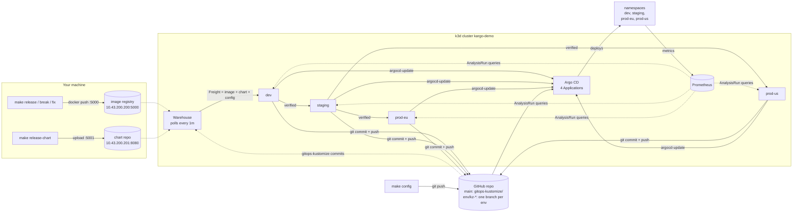

# Kargo + Argo CD + Kustomize on k3d

A local, reproducible demo of progressive delivery with **Kargo** (promotion and
verification) and **Argo CD** (deployment), using **podinfo** rendered with Helm
inside a classic **Kustomize** `base/` + `overlays/` layout. One command builds
everything; a scripted bad release shows Kargo stopping it before it reaches
production.

Each environment deploys from **its own branch** (`env/kz-<stage>`), written only
by Kargo. A change to `base/` therefore reaches an environment only when it is
promoted there, not all at once.



**Who does what**

- **The Warehouse** turns new artifacts into **Freight**. Each Freight bundles
  three things:
  - the podinfo **image** tag (from the image registry),
  - the podinfo **chart** version (from the chart repo),
  - a **config commit**: the latest commit touching `gitops-kustomize/` on `main`.

  A new version of any of them produces new Freight.
- **Every promotion is manual** (`ProjectConfig` in `kargo/kustomize/project.yaml`). A
  Stage only accepts Freight verified in the Stage before it:
  `dev → staging → prod-eu / prod-us`. The two prod
  regions are independent.
- **Kargo** only writes to Git and asks Argo CD to sync
  (`kargo/kustomize/promotion-task.yaml`). A promotion:
  - takes `gitops-kustomize/` **as of the Freight's commit**,
  - sets the image tag in the overlay (`kustomize-set-image`) and the chart
    version in the base,
  - commits that snapshot to the branch `env/kz-<stage>`, pushes, and runs
    `argocd-update`.
- **Argo CD** is the only thing that deploys: one Application per environment
  (`kz-<stage>`), auto-sync, `kustomize.buildOptions: --enable-helm`. Each app
  reads only its own branch.
- **Verification**: after every promotion, Kargo starts an Argo Rollouts
  `AnalysisRun` that queries Prometheus (`kargo/common/analysis-template.yaml`,
  a ClusterAnalysisTemplate). It
  checks that the success rate is at least 95% and that p95 latency is at most
  0.5s. Freight that fails verification can't move downstream.

## Prerequisites

- Docker, `kubectl`, `helm` (v3.13 or later), `git`, `jq`, `curl`, `openssl`
- `make tools` installs pinned `k3d`, `kustomize`, `gh`, `kargo` and `yq` into
  `./bin`. No sudo is needed.
- A GitHub token with read/write access to your copy of this repo, in `.env`
  (`cp .env.example .env`, set `GITHUB_USER` and `REPO_NAME`)
- Free localhost ports 8080, 8081, 9090, 5000 and 5001
- About 4 GB of RAM for Docker

## Run

```bash
make tools        # once
make up           # ~10 min on first run: cluster, platform, repo, apps, pipeline
make preflight    # all green? then you're ready
make down         # delete the cluster
```

| UI         | URL                   | Login                         |
|------------|-----------------------|-------------------------------|
| Argo CD    | http://localhost:8080 | `admin` / `make passwords`    |
| Kargo      | http://localhost:8081 | `admin` / `make passwords`    |
| Prometheus | http://localhost:9090 | none                          |

The demo script, with talking points, is in **[docs/DEMO.md](docs/DEMO.md)**.

Day-to-day commands:

```bash
make status                          # what each Stage runs + all Freight
make release TAG=6.16.0              # new image        -> new Freight
make release-chart VERSION=6.17.0    # new chart        -> new Freight
make config MSG="Kustomize config v2"  # change base/values.yaml on main -> new Freight
make promote STAGE=dev          # promote the newest Freight
make promote STAGE=prod-eu FREIGHT=<alias|name|image-tag>
make break                           # publish a bad image (6.16.1, HTTP 500s)
make fix                             # publish a good image (6.17.0)
export KUBECONFIG=$PWD/.kube/config  # use kubectl directly (context k3d-kargo-demo)
```

## Repository layout

```
cluster/k3d.yaml          k3d cluster, fixed port mappings, registry mirror config
platform/                 Helm values (Argo CD, Kargo, kube-prometheus-stack), registry, chart repo
gitops-kustomize/base/                helmCharts + shared values, ServiceMonitor, traffic generator
gitops-kustomize/overlays/<env>/      namespace, patch.yaml (replicas, color), images:
argocd/applications-kustomize.yaml    one Argo CD Application per env (kz-<stage>)
kargo/common/             ClusterAnalysisTemplate (verification)
kargo/kustomize/          Project + ProjectConfig, Warehouse, PromotionTask, Stages
scripts/                  up, down, preflight, status, release, release-chart, promote, tools
demo/                     break.sh / fix.sh / change-config.sh and the bad image
```

## How base + overlays are promoted

`gitops-kustomize/` is plain Kustomize:

- `base/` renders the podinfo chart (`helmCharts:`, values in `base/values.yaml`)
  and adds a ServiceMonitor and the traffic generator.
- `overlays/<env>/` sets the namespace, the image tag (`images:`), and a small
  `patch.yaml` for what really differs per env (replicas, UI color).

Changing `base/` changes every environment, but only when it is promoted to
it. For that, this project deploys each environment from **its own branch**,
following Kargo's standard pattern for base/overlays:

1. The Warehouse watches `gitops-kustomize/` on `main`. A commit there becomes
   Freight (together with the image and the chart).
2. Promoting Freight to a Stage takes `gitops-kustomize/` **as of the Freight's
   commit**. It sets the image tag in the overlay and the chart version in the
   base, then commits that snapshot to the branch `env/kz-<stage>`.
3. Argo CD app `kz-<stage>` reads only that branch. It still renders
   Helm-inside-Kustomize itself.

So a change to `base/values.yaml` on `main` reaches `kz-dev` when you
promote it there, then `kz-staging` once dev verified it, and so on.
Main is never deployed directly. Overlay changes are per environment by
nature, and travel with that env's next promotion.

## Pinned versions

| Component | Version |
|---|---|
| k3s (k3d image) | `rancher/k3s:v1.34.13-k3s1` |
| k3d CLI | v5.9.0 |
| cert-manager chart (needed by Kargo's webhooks) | v1.21.2 |
| kube-prometheus-stack chart | 92.16.2 |
| Argo Rollouts chart | 2.43.8 (v1.10.1) |
| Argo CD chart | 10.11.6 (v3.5.6) |
| Kargo chart | 1.12.5 |
| ChartMuseum (demo chart repo) | v0.15.0 |
| podinfo charts used | 6.15.0 (baseline), 6.17.0 |
| podinfo images used | 6.15.0 (baseline), 6.16.0, 6.17.0 + bad 6.16.1 |

Versions live in `scripts/lib.sh`, `scripts/tools.sh` and the files they configure.

## Design choices (where the brief left room)

- **One name everywhere.** Kargo Stage = overlay folder = `kz-<stage>`
  namespace = Argo CD Application = branch `env/kz-<stage>` (stages: `dev`,
  `staging`, `prod-eu`, `prod-us`).
- **Branch per environment.** Kargo writes a full snapshot of `gitops-kustomize/`
  to each env branch. The Warehouse watches only `main`, so Kargo's own commits
  never create Freight, and a base change reaches prod only by being promoted
  and verified like a new image.
- **In-cluster image registry and chart repo.** The demo has to publish new
  versions, including a deliberately broken image, and you can't publish to
  upstream podinfo. `make release` and `make release-chart` copy real upstream
  versions:
  - images go to a `registry:2` on `10.43.200.200:5000`,
  - charts go to a ChartMuseum on `10.43.200.201:8080`.

  Both use fixed ClusterIPs and plain HTTP. Set `IMAGE_SOURCE` in `.env` to
  copy images from elsewhere.
- **A bad release is a bad image.** `demo/break.sh` builds `6.16.1` from podinfo
  with its built-in fault injection always on. Every application request returns
  500, but `/healthz`, `/readyz` and `/metrics` keep working. Pods are Ready and
  Argo CD says *Healthy*, so only the metric-based verification catches it.
- **Verification only measures the tag under test.** The queries join podinfo's
  request metrics with `kube_pod_container_info{image=~".*:<tag>"}`, so metrics
  still coming from old pods can't hide a bad release. No traffic counts as a
  failure, and a per-environment traffic generator prevents it.
- **Recovery rolls forward.** `demo/fix.sh` publishes a newer good image
  (`6.17.0`) instead of rewriting history. The bad Freight stays visible as
  *failed* in dev.
- **Tuning verification speed.** Each run takes about 2.5 minutes: a 60s delay
  (so a full 1-minute `rate()` window exists, even in a brand-new namespace),
  then 5 measurements 20s apart. A bad release fails after about 1.5 minutes
  (two failed measurements). Change `interval` and `count`, or the thresholds, in
  `kargo/common/analysis-template.yaml`, or override them per Stage under
  `spec.verification.args`.

## Security notes

- No secrets are in Git. The GitHub token lives in `.env`
  (gitignored) and in the cluster twice:
  - as the Kargo secret `kargo-kustomize/github-creds`, used to push promotions and
    to watch `gitops-kustomize/`,
  - as the Argo CD repository secret `argocd/gitops-repo`, used to read the repo.

  Use a fine-grained token limited to this repo.
- Admin passwords are generated into `.secrets/` (gitignored). Argo CD and
  Kargo serve plain HTTP on localhost only. This setup is for a laptop, not for
  production.
- The scripts never use your default kubeconfig. They write `.kube/config` and
  always pass `--context k3d-kargo-demo`.

## Known limitations

- Warehouse polling means a new artifact shows up within about 1 minute (no
  webhooks on k3d). Click **Refresh** on the Warehouse in the Kargo UI to skip
  the wait.
- The registry and chart repo keep their data on PVCs, but only for the
  cluster's lifetime: `make down` deletes them.
- Kargo pushes straight to the `env/kz-*` branches. There's no PR flow, to keep the demo short.
- **VPNs:** many corporate VPNs route all private ranges, which hides Docker's
  network from the host. The k3d network therefore uses `198.18.0.0/24`, a range
  reserved for testing. If that clashes too, set `K3D_SUBNET` in `.env`;
  `make up` stops with a clear message when it detects the problem.
